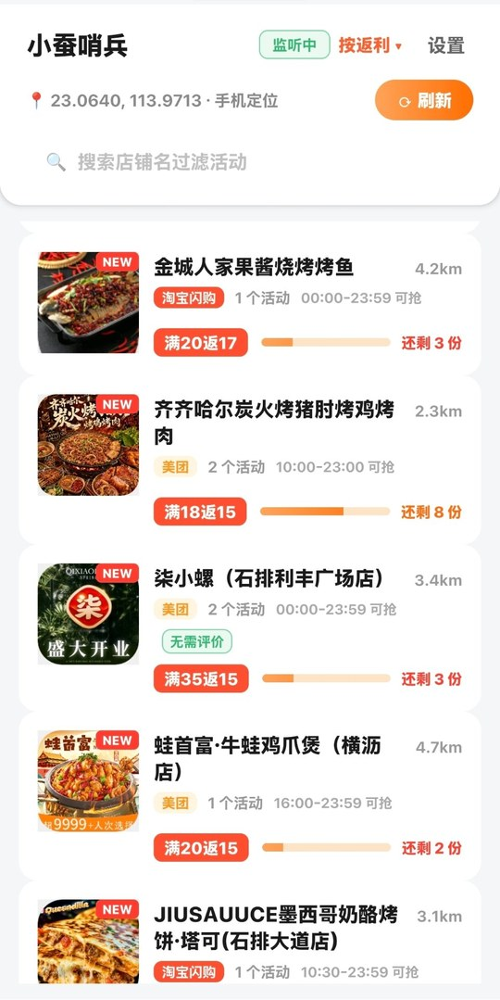
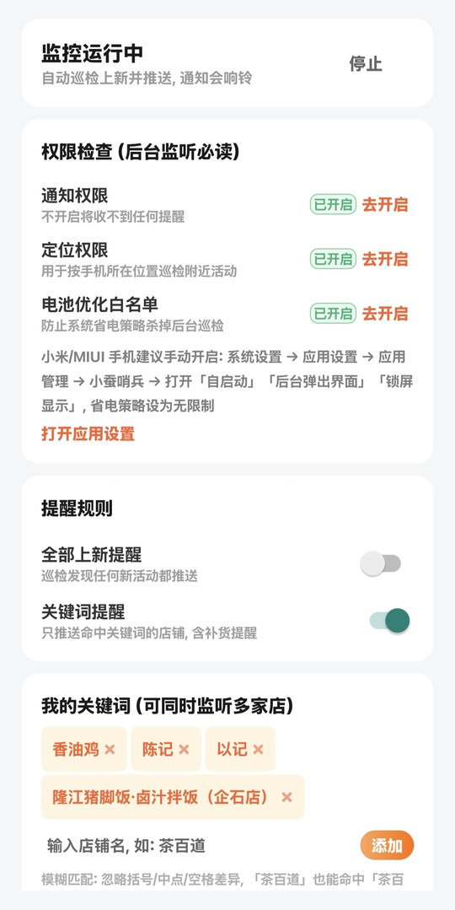
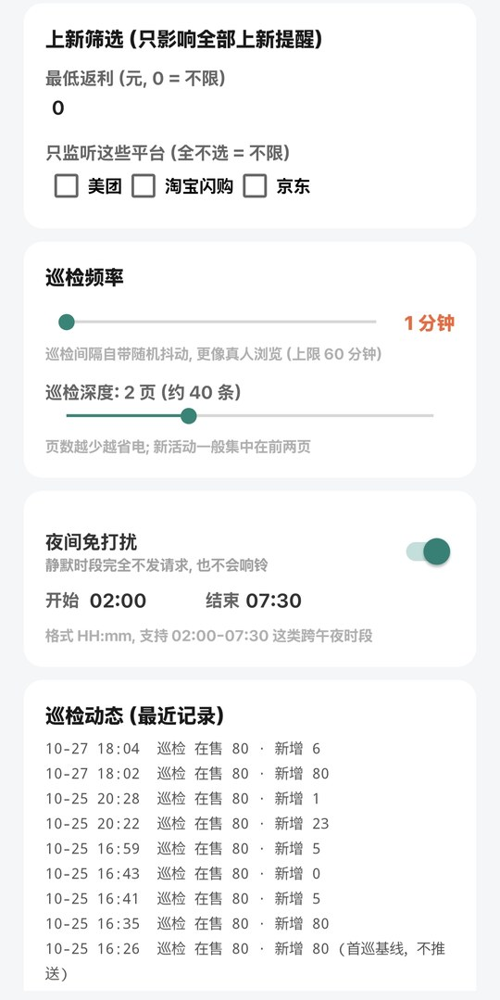

# 小蚕哨兵 (xiaocan-sentinel)

一个第三方开源的「小蚕惠生活」返利活动监控 Android 应用。它不修改小蚕 App 本身，也不干预任何下单行为，只在后台安静盯着你附近的返利活动：有新活动、或者你关注的店补货时，往通知栏推一条消息。

## 为什么写这个

小蚕的返利活动是随机上架的，App 内没有任何上新通知。经常是我常吃的那几家刚挂出来，名额几分钟就被抢完，等我打开 App 已经没了。所以写了这个东西：让手机替我盯着，上新第一时间弹通知。

## 功能

- 全量活动浏览：按手机定位展示周边返利活动，自动翻页到接口结束；一条活动一张卡，不合并、不隐藏
- 未开抢状态：活动已上线但尚未开抢时单独标注；首页可直接看到开抢时间，不再误显示为“已抢光”
- 开抢提醒：可设置提前 0~60 分钟提醒，默认提前 5 分钟；未开抢阶段不会误报补货
- 后台巡检：前台服务按可配置间隔（3~60 分钟，带随机抖动）拉取同一份全量活动数据
- 上新提醒：任何新活动出现即推送（可关），支持最低返利、平台筛选，批量上新自动合并为一条通知
- 关键词监听：维护自己的店铺关键词列表，模糊匹配（忽略括号、间隔号、空格差异），命中上新、未开抢或补货（名额从 0 恢复）时推送（可关）
- 后台恢复：划掉最近任务、开机、应用更新或系统回收后自动恢复监控；巡检结束后立即释放唤醒锁
- 夜间静默：静默时段内完全不发请求
- 异常退避：连续失败指数退避，最多放慢到 60 分钟一次并继续尝试，网络恢复后自动回归
- 排序切换：默认、距离、返利、名额、未开抢优先
- 免登录：未登录状态即可读取活动列表，不需要任何账号信息
- 首次启动引导：逐项授权通知/定位/电池白名单，完成后自动启动监控
- 巡检动态：设置页可查看最近每次巡检的时间与结果

## 工作原理

小蚕惠生活是一个 Flutter 应用，但业务请求走的是 Android 侧的 OkHttp，通过一个统一网关 RPC：`POST https://gw.xiaocantech.com/rpc`，用请求头 `servername` / `methodname` 路由到具体方法，请求体就是 JSON 参数。

对 `libapp.so`（Dart AOT）和 `classes.dex` 做静态分析（后者是壳，把拼接的多 dex 切出来再反编译即可），可以定位到请求签名逻辑，大致是：

```
X-Ashe  = MD5( MD5((servername + "." + methodname).toLowerCase()) + 毫秒时间戳 + 随机串 )
X-Garen = 毫秒时间戳
X-Nami  = 17 位随机串（登录态时会把 silkId 嵌进去）
```

签名不含请求体，也没有服务端下发的盐。也就是说只要按这个式子构造请求头，任何客户端都能调它的接口。本项目只用到了其中的活动列表查询接口，全部为只读请求。

另一件让事情变简单的事：小蚕的首页活动列表在未登录状态下就能访问，而且返回的数据比登录态更全（没有个性化过滤）。所以整个工具不需要你的任何账号信息，也就不存在 token 过期的问题。

App 是纯原生 Android 实现：

```
┌──────────────────────────────┐
│ 界面: ListView + ViewHolder  │ 原生渲染，滚动由系统接管
├──────────────────────────────┤
│ 网络: OkHttp + 上述签名       │ 只调用只读列表接口
├──────────────────────────────┤
│ 巡检: Foreground Service     │ 定时拉取 -> 与上次差分 -> 系统通知
├──────────────────────────────┤
│ 辅助: 定位 / 48h 防重保留期   │ 批量上新自动合并通知
└──────────────────────────────┘
```

差分算法的细节：每个活动以 promotion_id 为 key 记录首次出现时间、上次出现时间、名额、开抢时间和各类已推送标记；从列表消失的活动保留 48 小时才清理并进入「已见归档」，防止列表抖动导致同一活动被反复推送；批量上新（如整点集中上架）超过 3 条时自动合并为一条汇总通知。开抢时间按接口绝对日期配合官方时分计算，并用持久化状态保证“上线未开抢、即将开抢、已开抢”各只提醒一次；每日刷新不会被误判成新的开抢。

## 界面预览

| 首页 | 监听设置 | 巡检动态 |
|---|---|---|
|  |  |  |

## 目录结构

```
app-shell/  Android 工程（界面、网络、巡检、通知）
```

## 本地构建

需要 JDK 17 和 Android SDK（platform 34 + build-tools 34.0.0）。

```bash
cd app-shell
./build.sh
```

产物在 `app-shell/build/xc-sentinel.apk`。debug 签名，首次构建会自动生成 keystore。

也提供 GitHub Actions：推 tag（如 `v1.1`）会自动构建并把 APK 挂到对应 Release。

## 使用

安装后首次打开会有引导页，逐项授权通知、定位、电池优化白名单（小米手机另见页内 MIUI 指引），完成后监控自动启动。默认匿名模式，什么都不用填。想监听特定店铺就在关键词列表里加店名，模糊匹配，写「茶百道」也能命中「茶百道（石排店）」。

## 合规与风险（请务必阅读）

- 本项目仅用于个人学习和研究，请勿用于商业用途
- 本项目与「小蚕惠生活」及其开发方没有任何关系
- 自动化访问可能违反目标平台的服务条款，请自行评估并承担使用风险；请保持默认的低频巡检，不要改成高频爬取
- 仓库内不含任何抓包文件、反编译产物或账号数据
- 如果你是相关权利方且认为本项目不妥，请提 issue，我会处理

## License

MIT
